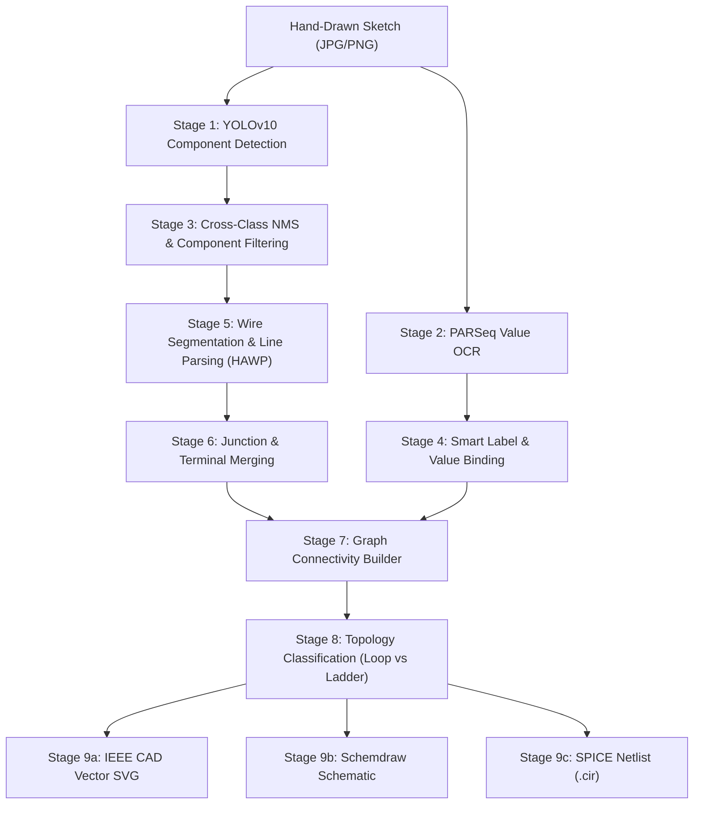

# PaperToCAD: Hand-Drawn Electronic Circuit to CAD Schematic & SPICE Netlist AI Engine

PaperToCAD is an end-to-end Computer Vision and Deep Learning system that transforms hand-drawn analog and digital circuit sketches into standardized, production-ready IEEE electronic CAD schematics (SVG/PNG) and SPICE simulation netlists (`.cir` / `.spice`).

---

## ⚡ Key Features

- **Component & Text Detection**: YOLOv10 object detection with cross-class Non-Maximum Suppression (NMS) to eliminate duplicate/phantom detections.
- **Optical Character Recognition (OCR)**: Integrated PARSeq model for reading resistor, capacitor, inductor values, and voltage/current specifications.
- **Smart Designation & Value Binding**: Automatically pairs designator labels (`R1`, `V1`, `LED1`) with electrical ratings (`220Ω`, `5V`, `10k`, `100mH`).
- **Topology-Aware Circuit Reconstruction**:
  - Uses detected component terminals and wire-net membership to connect components.
  - CAD renders only inferred nets; it does not add assumed series connections or ground rails.
- **Standardized Vector CAD Schematics**: Exports IEEE electronic schematics in Dark CAD, Light Blueprint, and Schemdraw textbook formats.
- **SPICE Netlist Synthesis**: Upload results preserve inferred node names and mark unreadable values as `VALUE_REQUIRED` rather than guessing values.
- **Interactive Web Studio**: Uploads run the full component, OCR, wire, and connectivity pipeline. Detected values can be edited and the schematic/SPICE output regenerated; the grounded assistant can calculate passive values when the required electrical inputs are supplied.
- **Grounded Circuit Assistant**: Without an LLM, it answers supported questions from detected components, connections, validation findings, and supplied calculation values. For open-ended conversational answers, configure `GROQ_API_KEY`, `OPENAI_API_KEY`, or `LLM_API_KEY` in `.env`; a local OpenAI-compatible server can instead use `LLM_BASE_URL` and `LLM_MODEL` (for example, an Ollama server at `http://localhost:11434/v1`).
- **Honest SPICE Export**: Missing component values are marked as required instead of silently substituting guessed values; such netlists are not simulation-ready until values are supplied.

Uploaded images without curated ground truth use the full topology pipeline, so CPU processing takes longer than component-only detection.

---

## 💻 System Prerequisites

- **Operating System**: Windows 10/11, Ubuntu 20.04+, or macOS
- **Python**: Version `3.10`, `3.11`, or `3.12` (Tested on Python 3.12 64-bit)
- **Compute Backend**:
  - **CPU**: Supported out-of-the-box (no GPU required)
  - **GPU (CUDA)**: Optional, NVIDIA GPU with CUDA 11.8+ or 12.1+ for accelerated inference

---

## 📦 Installation Guide

### Option 1: Quick Install using Pip & Virtualenv (Recommended)

1. **Clone or navigate to the repository**:
   ```bash
   cd PaperToCAD_LLM_CV
   ```

2. **Create a virtual environment**:
   - On Windows (PowerShell):
     ```powershell
     python -m venv venv
     .\venv\Scripts\Activate.ps1
     ```
   - On Linux / macOS:
     ```bash
     python3 -m venv venv
     source venv/bin/activate
     ```

3. **Install the dependencies**:
   ```bash
   pip install --upgrade pip
   pip install -r requirements.txt
   ```

### Option 2: Install using Conda

1. **Create and activate the Conda environment**:
   ```bash
   conda env create -f environment.yml
   conda activate papertocad
   ```

### 3. Verify Model Weights

Ensure model weights exist in the `weights/` directory:
- `weights/yolo/best.pt` (YOLOv10 circuit object detector)
- `weights/parseq/best_parseq.pt` (PARSeq optical character recognizer)

*(If weights are missing, download them using `python scripts/download_weights.py`.)*

---

## 🚀 Quick Start (Single Entry Point)

To run the entire Paper2CAD application, use the single entry point:

```bash
python main.py
```

*Or on Windows, simply double-click **`start.bat`**.*

This automatically launches the server on `http://localhost:8000` and opens your browser.

### Advanced Flags
```bash
python main.py --port 8080      # Run on custom port
python main.py --no-browser     # Run in headless/server mode
python main.py --mcp            # Launch official Model Context Protocol (MCP) server
```

### Connect an MCP client

The workspace includes a VS Code MCP configuration at `.vscode/mcp.json`. Open this
repository in VS Code and start the `papertocad` server from the MCP servers view.
The server uses stdio and exposes tools to process a local sketch end to end,
inspect and validate circuits, render schematics, export SPICE netlists, simulate
circuits, and explain circuit topology.

Use the `process_sketch` tool with an absolute image path, for example
`D:\Projects\circuits\my_sketch.png`. It runs the full CV pipeline and saves
each run's inputs, intermediate files, logs, reconstructed graph, schematic, and
SPICE netlist under `outputs/mcp_jobs/<job-id>/`. The required YOLO, PARSeq, and
HAWP model weights must be installed first; see `scripts/download_weights.py`.
The pipeline uses CUDA when available and otherwise runs on CPU.

The MCP Python SDK requires Python 3.10 or newer. Install the project requirements
with that interpreter before starting the server. The Conda reproduction
environment remains pinned to Python 3.9 and does not support the MCP server.
   - **Explore View Modes**:
     - **Computerized CAD Schematic**: Clean, IEEE-standardized orthogonal CAD vector drawing with Dark / Light Blueprint themes.
     - **Schemdraw**: Normalized textbook-grade electronic circuit diagram.
     - **Detection Boxes**: Color-coded YOLOv10 component bounding boxes and confidence scores.
     - **Hand Drawing**: Your original unprocessed drawing.
   - **Inspect Components**: Browse the **Component Inventory** tab to inspect crops of each detected resistor, capacitor, battery, or diode.
   - **Export SPICE & JSON**: Switch to the **SPICE Netlist** or **Structured JSON** tab to copy or download simulation decks (`.cir` / `.spice`).

---

### Method 2: Command-Line Pipeline (CLI)

To process circuits in batch mode using the full 9-stage CV pipeline:

```bash
python scripts/run_pipeline.py
```

Outputs are automatically generated under `outputs/run1/`:
- `outputs/run1/yolo_detect/`: Raw component detections
- `outputs/run1/ocr_parseq/`: Component value bindings
- `outputs/run1/final_result/json/`: Topological circuit connectivity graphs
- `outputs/run1/spice_netlists/`: Synthesized `.spice` simulation netlists

---

### Method 3: Automated Test Suite

Run unit and topology verification tests to validate circuit synthesis:

```bash
# 1. Test topology classification (single-loop vs parallel ladder)
python tests/test_classify.py

# 2. Test cross-class deduplication and smart label binding
python tests/test_fix_hallucination.py

# 3. Test SPICE netlist synthesis
python tests/test_spice_synthesis.py

# 4. Test Schemdraw rendering on single-loop LED circuit
python tests/test_render_led.py

# 5. Test Schemdraw rendering on multi-branch RLC ladder
python tests/test_render_cir1_v2.py
```

---

## 📁 Repository Organization

```text
PaperToCAD_LLM_CV/
├── assets/                  # Character sets, metadata, and typography
│   └── meta/                # parseq_charset.txt and category metadata
├── configs/                 # YAML configuration files (paths, pipelines)
├── data/                    # Circuit datasets
│   ├── inputs/              # Sample hand-drawn circuit sketches (cir1–cir5)
│   └── ground_truth/        # Annotated circuit ground-truth JSON files
├── outputs/                 # Output artifacts (auto-generated, gitignored)
│   ├── run1/                # Pipeline stage execution artifacts
│   ├── ui_jobs/             # Web Studio uploaded jobs and crops
│   └── test_previews/       # Verification and preview schematic renders
├── scripts/                 # Pipeline execution scripts
│   ├── run_pipeline.py      # End-to-end 9-stage pipeline runner
│   ├── download_weights.py  # Model weights downloader
│   └── run_all.sh           # Shell batch execution script
├── src/                     # Core Python modules
│   └── pipeline/            # 9-stage CV pipeline components
│       ├── cad_schematic_renderer.py   # Vector CAD & Schemdraw engine
│       ├── build_spice_netlists.py     # SPICE deck synthesizer
│       ├── build_connections.py        # Wire trace & terminal connectivity
│       ├── build_final_json.py         # Graph JSON builder
│       ├── merge_points.py             # Junction & crossover fusion
│       ├── remove_components.py        # Line inpainting / segmentation
│       ├── refine_component_types.py   # Subtype classifier (DINOv2)
│       └── fuse_yolo_parseq.py         # OCR & component binding
├── tests/                   # Dedicated test suite
│   ├── __init__.py
│   ├── test_classify.py            # Topology classification tests
│   ├── test_fix_hallucination.py   # Deduplication & label binding tests
│   ├── test_spice_synthesis.py     # SPICE netlist synthesis tests
│   ├── test_render_cir1_v2.py      # Multi-branch Schemdraw test
│   └── test_render_led.py          # Single-loop Schemdraw test
├── third_party/             # External framework submodules
│   ├── HAWP/                # Holistic Attraction Wireline Parser
│   ├── parseq-main/         # Permuted Autoregressive Sequence OCR
│   └── mmpose/              # Keypoint terminal detector
├── ui/                      # Web Studio Application
│   ├── server.py            # FastAPI backend server
│   └── static/              # Modern dark-mode web application (HTML/CSS/JS)
├── weights/                 # Model checkpoints (YOLO, PARSeq, ViTPose)
├── run_ui.py                # Web Studio launcher entry point
├── README.md                # Project documentation & guide
├── requirements.txt         # Pip package requirements
├── environment.yml          # Conda environment configuration
└── .gitignore               # Git exclude rules
```

---

## 📊 Pipeline Stages



---

## ❓ Troubleshooting & FAQs

### 1. Port 8000 is already in use
If another application is using port `8000`, specify a custom port in `run_ui.py`:
```bash
python -c "import uvicorn; uvicorn.run('ui.server:app', host='127.0.0.1', port=8080)"
```
Then visit `http://localhost:8080`.

### 2. First-time model inference delay
On the first request after server startup, PyTorch loads YOLOv10 and PARSeq model weights into memory. This initial initialization takes 5–10 seconds on CPU. Subsequent inference requests execute rapidly in 1–3 seconds.

### 3. Windows Terminal Character Encoding
If running on Windows PowerShell / CMD and printing Greek characters (e.g. `Ω`), scripts automatically configure UTF-8 output (`sys.stdout.reconfigure(encoding='utf-8')`).

---

## 📜 License

MIT License. See [LICENSE](LICENSE) for details.
